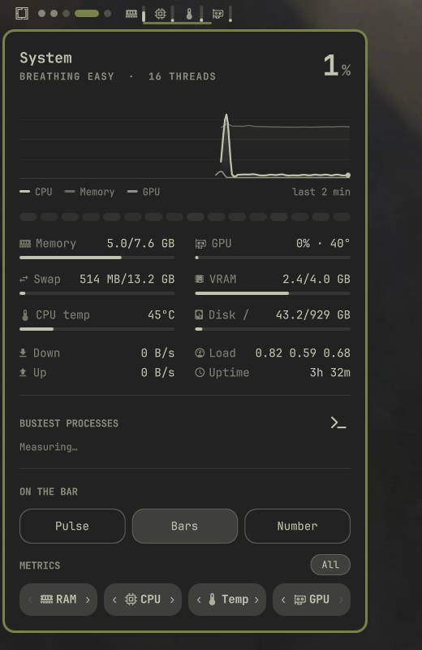

<div align="center">

# Pulse

**A quiet, versatile system monitor for the [Omarchy](https://omarchy.org) bar — live sparklines, slim meters, or numbers with GPU support, reorderable multi-metric layout, and an in-depth system panel.**

[Русская версия](README.ru.md)

<br>

<p align="center">
  
</p>

</div>

<br>

## Three looks on the bar

Pick your preferred style on the fly with **Right click** or inside the panel. Works cleanly on both horizontal and vertical bars:

| Look | Preview | Description |
|---|---|---|
| **Pulse** |  | Smooth left-to-right waveforms. Auto-scales so an idle machine still breathes gently instead of lying flat. Sends out ripples when alerting. |
| **Bars** |  | Crisp icons and slim proportional meters for each metric. |
| **Number** |  | Compact icons with exact numerical percentages and temperatures. |

<br>

## Highlights

- **Multi-Metric Everywhere**: Follow any combination or all metrics (`CPU`, `RAM`, `GPU`, `CPU temperature`, `GPU temperature` (when reported by NVIDIA)) simultaneously across all three visual styles.
- **Unified Reordering & Selection**: Toggle components active/inactive with a click, and rearrange their order using `‹` / `›` buttons. Changes reflect instantly on the bar and save automatically.
- **Full GPU Support**: Automatic vendor detection (NVIDIA via `nvidia-smi`, AMD via `sysfs DRM`), monitoring load %, VRAM usage, and temperatures with a custom Lucide GPU vector icon.
- **Horizontal Flow Everywhere**: On vertical bars, pulse sparklines flow left-to-right rather than vertically, maintaining visual clarity.
- **Deep System Panel**:
  - Live CPU hero status with workload mood and thread count.
  - 2-minute rolling graph of CPU, RAM, and GPU.
  - Per-thread core activity heatmap.
  - Real-time meters: Memory, Swap, GPU, VRAM, CPU Temp, Root Disk.
  - Network download/upload rates, load averages, uptime, and top 5 busiest processes.
  - Quick launcher for `btop`.

<br>

## Installation

### Via Omarchy CLI

```bash
omarchy plugin add https://github.com/SanchoKusika/omarchy-pulse
```

### Manual Installation

Clone the repository into your Omarchy plugins directory and restart the shell:

```bash
git clone https://github.com/SanchoKusika/omarchy-pulse.git ~/.config/omarchy/plugins/io.github.sanchokusika.pulse
omarchy restart shell
```

Add Pulse to your bar in `~/.config/omarchy/shell.json` under `bar.layout`:

```json
{
  "id": "io.github.sanchokusika.pulse"
}
```

<br>

## Removal

To remove the plugin safely:

```bash
omarchy plugin remove io.github.sanchokusika.pulse
```

Or manually remove the directory and reload the shell:

```bash
rm -rf ~/.config/omarchy/plugins/io.github.sanchokusika.pulse
omarchy restart shell
```

<br>

## Controls

| Action | Shortcut / Gesture |
|---|---|
| **Open / Close Panel** | `Left Click` |
| **Next Bar Look** | `Right Click` (or `←` / `→` inside panel) |
| **Open `btop`** | `Middle Click` (or press `b` / `Enter` in panel) |
| **Cycle Metric Presets** | `Mouse Wheel` over widget |
| **Dismiss Panel** | `Escape` or click outside |
| **Switch Neighbor Panel** | `Tab` / `Shift+Tab` |

<br>

## Configuration

Settings are saved in `~/.config/omarchy/shell.json`:

```json
{
  "id": "io.github.sanchokusika.pulse",
  "style": "bars",
  "metrics": ["mem", "cpu", "temp", "gpu"],
  "metricOrder": ["mem", "cpu", "temp", "gpu"],
  "interval": 2,
  "alert": 90
}
```

| Key | Description | Default |
|---|---|---|
| `style` | Bar look: `"pulse"`, `"bars"`, or `"text"` | `"pulse"` |
| `metrics` | Active metrics displayed on the bar: `["cpu", "mem", "gpu", "temp", "gpuTemp"]` | `["cpu"]` |
| `metricOrder` | User's preferred sequence of components | `["cpu", "mem", "gpu", "temp", "gpuTemp"]` |
| `interval` | Sampling frequency in seconds (1–10) | `2` |
| `alert` | Load % threshold for urgent color and ripple alerts (50–100) | `90` |

<br>

## CLI / IPC

Pulse provides instant CLI controls via `omarchy-shell`:

```bash
omarchy-shell io.github.sanchokusika.pulse toggle
omarchy-shell io.github.sanchokusika.pulse style bars
omarchy-shell io.github.sanchokusika.pulse metrics mem,cpu,gpu
omarchy-shell io.github.sanchokusika.pulse move 0 1
```

<br>

## License

MIT © [Aleksandr (SanchoKusika)](https://github.com/SanchoKusika)
