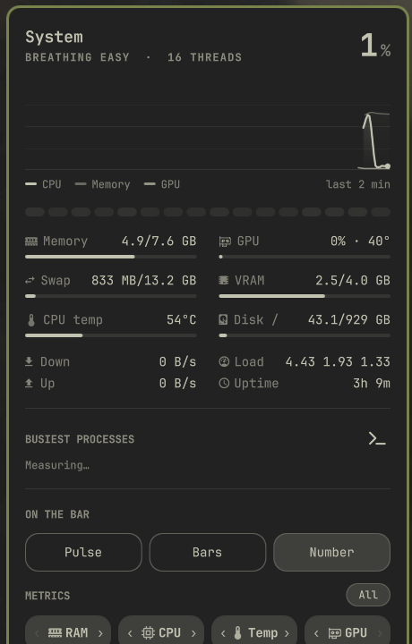
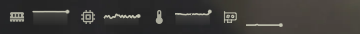
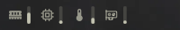
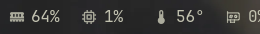

<div align="center">

# Pulse

**Лаконичный и функциональный системный монитор для бара [Omarchy](https://omarchy.org) — графики пульса, компактные столбцы или цифровые значения с поддержкой GPU, произвольным порядком компонентов и подробной панелью управления.**

[English version](README.md)

<br>

<p align="center">
  
</p>

</div>

<br>

## Три стиля на баре

Переключайте стиль на лету **правым кликом** по виджету или в панели. Полная поддержка горизонтальных и вертикальных баров:

| Стиль | Превью | Описание |
|---|---|---|
| **Пульс (Pulse)** |  | Плавные графики слева направо. Автомасштабирование (даже в покое график «дышит», а не лежит плоской линией). При превышении порога тревоги точка пульсирует кольцами. |
| **Столбцы (Bars)** |  | Чёткие иконки и аккуратные пропорциональные индикаторы для каждой метрики. |
| **Число (Number)** |  | Компактные иконки с точными процентными и температурными значениями. |

<br>

## Главные возможности

- **Мульти-метрики**: Выбирайте любую комбинацию или все метрики одновременно (`CPU`, `RAM`, `GPU`, `Temp`) во всех трёх стилях.
- **Единый блок порядка и выбора**: Клик по чипу включает или отключает метрику, а стрелки `‹` / `›` меняют их очерёдность. Изменения мгновенно применяются на баре и сохраняются в `shell.json`.
- **Поддержка GPU**: Автоматическое определение видеокарты (NVIDIA через `nvidia-smi`, AMD через `sysfs DRM`), мониторинг загрузки, видеопамяти (VRAM) и температуры с векторной иконкой Lucide GPU.
- **Горизонтальное течение везде**: На вертикальных барах графики пульса идут слева направо (а не сверху вниз), сохраняя читаемость.
- **Подробная панель системы**:
  - Индикатор загрузки ЦП со статусом нагрузки и количеством активных потоков.
  - Двухминутный график истории ЦП, памяти и ГП.
  - Тепловая карта загрузки каждого ядра процессора.
  - Индикаторы в реальном времени: Память, Swap, ГП, VRAM, Температура, Диск `/`.
  - Скорость приёма и отдачи сети, Load Average, аптайм и топ-5 самых занятых процессов.
  - Быстрый запуск `btop`.

<br>

## Управление

| Действие | Жест / Клавиша |
|---|---|
| **Открыть / Закрыть панель** | `Левый клик` |
| **Сменить стиль бара** | `Правый клик` (или `←` / `→` в панели) |
| **Открыть `btop`** | `Средний клик` (или клавиша `b` / `Enter` в панели) |
| **Переключить пресеты метрик** | `Колесо мыши` над виджетом |
| **Закрыть панель** | `Escape` или клик вне панели |
| **Перейти к соседней панели бара** | `Tab` / `Shift+Tab` |

<br>

## Конфигурация

Параметры сохраняются в `~/.config/omarchy/shell.json`:

```json
{
  "id": "io.github.sanchokusika.pulse",
  "style": "bars",
  "metrics": ["mem", "cpu", "temp", "gpu"],
  "metricOrder": ["mem", "cpu", "temp", "gpu"],
  "interval": 2,
  "alert": 90
}
```

| Параметр | Описание | По умолчанию |
|---|---|---|
| `style` | Стиль отображения: `"pulse"`, `"bars"` или `"text"` | `"pulse"` |
| `metrics` | Список активных метрик на баре: `["cpu", "mem", "gpu", "temp"]` | `["cpu"]` |
| `metricOrder` | Пользовательский порядок компонентов | `["cpu", "mem", "gpu", "temp"]` |
| `interval` | Интервал обновления в секундах (1–10) | `2` |
| `alert` | Порог тревоги в % для срочного цвета и пульсации (50–100) | `90` |

<br>

## CLI / IPC

Управление через командную строку с помощью `omarchy-shell`:

```bash
omarchy-shell io.github.sanchokusika.pulse toggle
omarchy-shell io.github.sanchokusika.pulse style bars
omarchy-shell io.github.sanchokusika.pulse metrics mem,cpu,gpu
omarchy-shell io.github.sanchokusika.pulse move 0 1
```

<br>

## Лицензия

MIT © [Aleksandr (SanchoKusika)](https://github.com/SanchoKusika)
