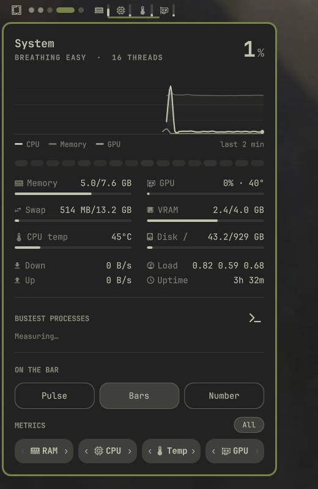

<div align="center">

# Pulse

**一款安静、多功能的 [Omarchy](https://omarchy.org) 状态栏系统监视器 —— 实时波形、纤细的条形仪表或数字读数，支持 GPU 监控，多指标可自由排序，并提供详尽的系统面板。**

[English version](README.md) · [Русская версия](README.ru.md)

<br>

<p align="center">
  
</p>

</div>

<br>

## 状态栏上的三种外观

用**右键**或面板内的按钮随时切换。横向和纵向状态栏都能正常显示：

| 外观 | 预览 | 说明 |
|---|---|---|
| **波形 (Pulse)** |  | 流畅的波形从左向右流动。自动缩放，机器空闲时也会轻轻起伏，而不是一条毫无生气的直线。触发警报时，波形头部会泛起涟漪。 |
| **柱状 (Bars)** |  | 清晰的图标，每项指标配一条纤细的比例指示条。 |
| **数字 (Number)** |  | 紧凑的图标，搭配精确的百分比和温度数值。 |

<br>

## 主要特性

- **多指标，处处可用**：三种外观都可同时显示任意组合或全部指标（CPU、内存、GPU、温度）。
- **统一的排序与选择**：点击即可开启或关闭某项指标，使用 `‹` / `›` 按钮调整顺序。改动会立即反映到状态栏并自动保存。
- **全面的 GPU 支持**：自动识别显卡厂商（NVIDIA 通过 `nvidia-smi`，AMD 通过 `sysfs DRM`），监视占用率、显存用量和温度，并使用定制的 Lucide GPU 矢量图标。
- **横向流动**：在纵向状态栏上，波形依然从左向右流动，而非纵向绘制，保持清晰易读。
- **详尽的系统面板**：
  - 实时 CPU 概览，显示负载状态和线程数。
  - CPU、内存和 GPU 最近两分钟的滚动图表。
  - 各逻辑核心（线程）的活跃度热力图。
  - 实时仪表：内存、交换空间、GPU、显存、CPU 温度和根分区。
  - 网络下行/上行速率、平均负载、运行时间，以及最繁忙的 5 个进程。
  - 一键启动 `btop`。

<br>

## 安装

### 通过 Omarchy CLI

```bash
omarchy plugin add https://github.com/SanchoKusika/omarchy-pulse
```

### 手动安装

将仓库克隆到 Omarchy 插件目录，然后重启 shell：

```bash
git clone https://github.com/SanchoKusika/omarchy-pulse.git ~/.config/omarchy/plugins/io.github.sanchokusika.pulse
omarchy restart shell
```

在 `~/.config/omarchy/shell.json` 的 `bar.layout` 下把 Pulse 加入状态栏：

```json
{
  "id": "io.github.sanchokusika.pulse"
}
```

<br>

## 卸载

安全地移除插件：

```bash
omarchy plugin remove io.github.sanchokusika.pulse
```

或者手动删除目录并重新加载 shell：

```bash
rm -rf ~/.config/omarchy/plugins/io.github.sanchokusika.pulse
omarchy restart shell
```

<br>

## 操作方式

| 操作 | 快捷键 / 手势 |
|---|---|
| **打开 / 关闭面板** | `左键单击` |
| **循环切换状态栏外观** | `右键单击`（或面板内 `←` / `→`） |
| **打开 `btop`** | `中键单击`（或面板内按 `b` / `Enter`） |
| **循环切换指标预设** | 在组件上滚动鼠标滚轮 |
| **关闭面板** | `Esc` 或点击面板外部 |
| **切换到相邻面板** | `Tab` / `Shift+Tab` |

<br>

## 配置

设置保存在 `~/.config/omarchy/shell.json`：

```json
{
  "id": "io.github.sanchokusika.pulse",
  "style": "bars",
  "metrics": ["mem", "cpu", "temp", "gpu"],
  "metricOrder": ["mem", "cpu", "temp", "gpu"],
  "interval": 2,
  "alert": 90
}
```

| 键 | 说明 | 默认值 |
|---|---|---|
| `style` | 状态栏外观：`"pulse"`、`"bars"` 或 `"text"` | `"pulse"` |
| `metrics` | 状态栏上显示的指标：`["cpu", "mem", "gpu", "temp"]` | `["cpu"]` |
| `metricOrder` | 指标的自定义排列顺序 | `["cpu", "mem", "gpu", "temp"]` |
| `interval` | 采样间隔，单位为秒（1–10） | `2` |
| `alert` | 触发警报色和涟漪提示的负载百分比阈值（50–100） | `90` |

<br>

## CLI / IPC

Pulse 通过 `omarchy-shell` 提供快捷的命令行控制：

```bash
omarchy-shell io.github.sanchokusika.pulse toggle
omarchy-shell io.github.sanchokusika.pulse style bars
omarchy-shell io.github.sanchokusika.pulse metrics mem,cpu,gpu
omarchy-shell io.github.sanchokusika.pulse move 0 1
```

<br>

## 许可证

MIT © [Aleksandr (SanchoKusika)](https://github.com/SanchoKusika)
